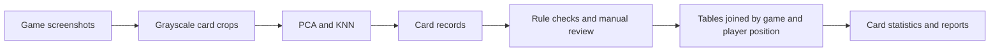

# Through the Ages — Image Recognition & Data Pipeline

**English** | [简体中文](README.zh-CN.md)

A personal project by **Weida Feng** · **Original work: 2022 · Code organization and additional verification: 2026**

Which cards do players choose, and how often do the players using them win?

This project studies two-player games of *Through the Ages*, a strategy board game where players choose leader and wonder cards as their civilizations develop. I built a Python workflow to turn visual game timelines into structured records, check recognition errors, and analyze card usage and observed win rates.

The historical study processed **14,557 distinct games** across **48 leaders and 32 wonders**. This repository includes the implementation, aggregate results, and runnable public examples.

## What I built

- **Screenshot extraction and classification:** historical Windows screenshot automation, card cropping, and PCA/KNN models trained with manually labeled data from approximately 900 games.
- **Recognition quality control:** duplicate-card, shared-card, and age-order checks, with manual review of anomalies. An empty-region diagnostic retains raw predictions and records findings separately.
- **Data preparation:** four normalized tables for games, players, leader slots, and wonders. The 2026 pandas workflow joins by game identity and player position, validates outcomes, and reconciles historical Excel sources.
- **Descriptive analysis:** card use counts, selection rates, observed win rates, nominal Wilson intervals, and sensitivity to population definitions and pending review cases.

The [case study](docs/case_study.md) explains the main decisions; the [project evidence guide](docs/project_evidence.md) links each contribution to its implementation and results.

## From screenshots to analysis



The saved models use PCA retaining **95% of variance**, whitening, and **K=3 nearest neighbors**. The approximately 900-game labeling effort is represented by **6,958 leader crops and 4,980 wonder crops**. Leader features use the central 48×48 pixels of a 144×144 crop; wonder features use the full 64×120 crop.

## A recognition error, and how it is checked

The classifier assigns every input to a known card class, including an empty region. Both inputs below receive the same label:

| Input                                                        | Raw prediction       | Difference from empty template | Diagnostic                 |
| ------------------------------------------------------------ | -------------------- | -----------------------------: | -------------------------- |
| Silk Road<br> | 丝绸之路 (Silk Road) |                        128,913 | Preserve as a real card    |
| Empty region<br> | 丝绸之路 (Silk Road) |                            550 | Flag as an empty candidate |

The diagnostic sums absolute grayscale differences over a 50×50 region, flagging values below **5,000** without replacing raw predictions. Deleting every Silk Road prediction would also remove valid cards. The threshold is checked on the supplied examples, rather than validated across all possible screenshots.

See the [case study](docs/case_study.md) and [recorded crop predictions](reports/public-demo/vision/crop_predictions.json).

## Analysis results

The primary analysis contains **11,963 games with neither resignation nor expiration flags**. Resigned games are reported separately because their recorded card usage differs substantially.

| Finding                                                      | Analytical decision                                          |
| ------------------------------------------------------------ | ------------------------------------------------------------ |
| Final-era leader slots are absent in **7.28%** of primary-population player slots, versus **76.27%** in resigned games | Report the populations separately                            |
| Adding resigned games changes individual card win rates by up to **2.02 percentage points** | Show sensitivity to the population definition                |
| Excluding three pending recognition review cases changes primary-population win rates by at most **0.17 percentage points** | Quantify their aggregate effect while keeping the cases open for review |

**Leaders**


**Wonders**


**Selection rate = card uses / games. Observed win rate = winning uses / card uses.** Counts and nominal 95% Wilson intervals accompany the estimates. Player ability, game state, other card choices, and card availability are not controlled; intervals do not adjust for repeated-player dependence. These are descriptive associations, not a causal ranking of card strength.

Explore the [full report](reports/statistics/report.md), [all 80 cards across seven population views](reports/statistics/card_statistics.csv), or [metric definitions and data dictionary](docs/methods.md).

## Run the public analysis example

The **20-game curated sample** contains 40 player rows, 160 leader slots, and 92 wonder uses. Identifiers use consistent sample-local pseudonyms; card names, outcomes, and ending flags are preserved from the historical preparation.

Run from the repository root using **Python 3.12**. Environment setup and Windows instructions are in [installation and runnable examples](docs/environment.md).

```bash
python -m pip install -r requirements/analysis.txt
python -m pip install --no-deps -e .
python examples/analyze_sample.py --output results/demo-analysis
python -m unittest discover -s tests -v
```

Expected results: **15 completed / 5 resigned / 20 total sample games**, **240 card-statistic rows**, and **12 leader-coverage rows**. In the analysis environment, **35 tests pass and two model tests are skipped**. Recorded outputs are in [reports/public-demo/analysis](reports/public-demo/analysis/sample_analysis.json).

Choose a new empty output directory for each run. The curated sample demonstrates the code; it is not random and cannot reproduce the full 14,557-game estimates.

The optional [card-crop recognition example](examples/recognize_crops.py) requires a **separate legacy model environment**. Follow the [model installation instructions](docs/environment.md) before running:

```bash
python examples/recognize_crops.py --output results/demo-vision
```

## Verification and public scope

Recorded full-archive checks include **141,453 reconciled workbook fields** and **252 reproduced Excel statistics**, with zero mismatches, plus offline processing of **20 complete screenshots**. The underlying workbooks, full player records, complete screenshots, and identity mappings remain local. See [verification and provenance](docs/verification.md) and [public scope](docs/public_scope.md).

The public recognition demo starts with selected crops. Historical-reference agreement is not independent test-set accuracy. Full retraining requires the complete labeled image set, and live Windows capture has not been retested.

The [GitHub Actions workflow](.github/workflows/checks.yml) runs analysis tests and the sample example with Python 3.12. The public analysis workflow has run successfully on GitHub. It also checks the tracked public files against the recorded manifest. See [GitHub Actions](https://github.com/weida-feng/Through-the-Ages-Image-Recognition/actions) for the latest checks.

## Project history

- **2022:** screenshot automation, cropping, PCA/KNN recognition, text output, anomaly checks, and manual verification. Data import and statistical analysis were performed in Excel.
- **2026:** organized the historical methods into Python modules, added configurable paths, commands and tests, and automated preparation and analysis with pandas. Added reconciliation, the public sample, and demonstration scripts.

See [code organization and project history](docs/code_organization.md).

## Repository contents

```text
src/tta_pipeline/      Recognition, validation, preparation, and analysis
examples/              Public analysis and selected-crop demonstrations
data/demo/             Pseudonymized, curated 20-game sample
assets/                Original models, selected crops, and empty template
reports/statistics/    Full historical aggregate tables and figures
reports/public-demo/   Recorded public example outputs
docs/                  Case study, methods, provenance, and installation
tests/                 Unit, sample-data, and conditional model checks
scripts/               Public-file manifest maintenance and verification
.github/workflows/     Public analysis checks
```

## License

The author's code and accompanying documentation are licensed under [MIT](LICENSE). Game images, model artifacts, datasets, and generated research outputs are outside this code license. See [license scope](LICENSE_SCOPE.md) and [third-party materials](THIRD_PARTY.md).
