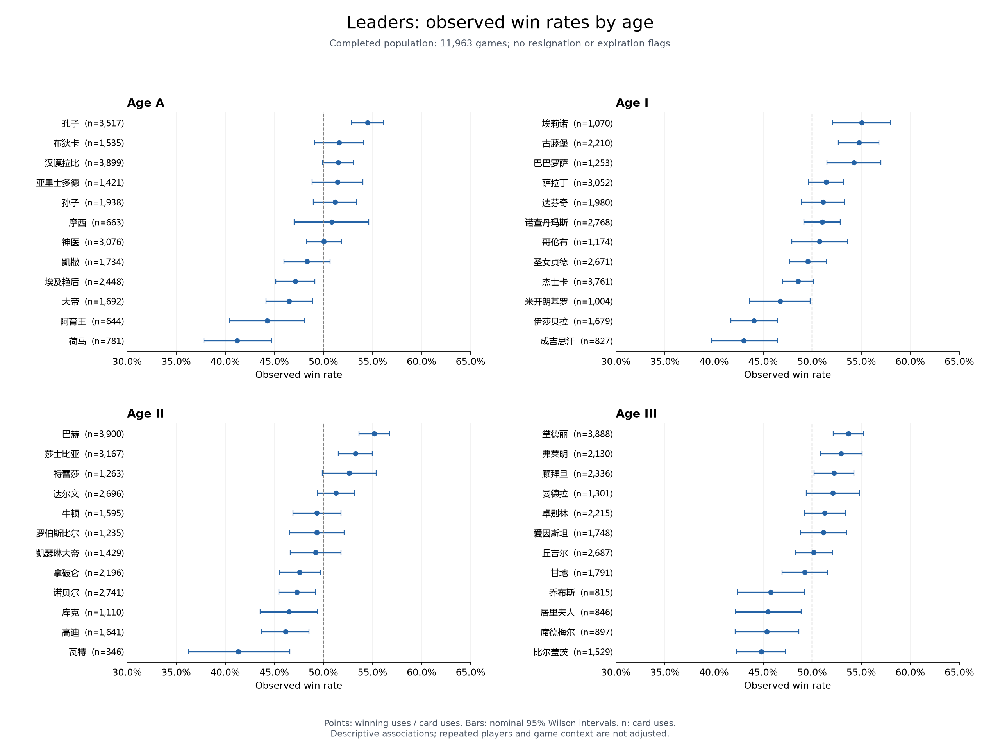

# Through the Ages — 图像识别与数据处理流程

[English](README.md) | **简体中文**

本页为中文译版，英文 README 为主要版本。文档与报告链接沿用英文版。

**Weida Feng** 的个人项目 · **原始工作：2022 年 · 代码整理与补充验证：2026 年**

玩家会选择哪些卡牌？使用这些卡牌的玩家获胜的频率有多高？

本项目研究策略桌游《历史巨轮》（*Through the Ages*）的双人对局。在游戏中，玩家随着文明的发展选择领袖与奇迹卡牌。我构建了一套 Python 工作流程，将可视化的游戏时间线转换为结构化记录，检查识别错误，并分析卡牌使用情况与观测胜率。

历史研究处理了 **14,557 场不同的对局**，涵盖 **48 位领袖和 32 个奇迹**。本仓库包含实现代码、汇总结果和可运行的公开示例。

## 我完成的工作

- **截图提取与分类：** 原有的 Windows 自动截图、卡牌图像裁剪，以及使用约 900 场对局的人工标注数据训练的 PCA/KNN 模型。
- **识别质量控制：** 检查重复卡牌、双方共用卡牌和时代顺序，并人工复核异常。空白区域诊断保留原始预测，单独记录诊断结果。
- **数据准备：** 将对局、玩家、领袖栏位和奇迹整理为四张规范化表。2026 年新增的 pandas 流程按对局标识和玩家席位连接数据，验证胜负结果，并与历史 Excel 数据源逐项核对。
- **描述性分析：** 统计卡牌使用次数、选择率、观测胜率、名义 Wilson 置信区间，以及分析样本定义和待复核案例对结果的影响。

[案例研究](docs/case_study.md)说明了主要决策；[项目成果与证据指南](docs/project_evidence.md)将各项工作对应到具体实现和结果。

## 从截图到分析


已保存的模型使用保留 **95% 方差**的 PCA、白化处理，以及 **K=3 的近邻分类**。约 900 场对局的标注工作产生了 **6,958 张领袖裁剪图和 4,980 张奇迹裁剪图**。领袖特征取自 144×144 裁剪图中心的 48×48 像素区域；奇迹特征使用完整的 64×120 裁剪图。

## 一个识别错误，以及如何检查它

分类器会将每个输入归入某个已知卡牌类别，空白区域也不例外。下面两个输入得到了相同的标签：

| 输入 | 原始预测 | 与空白模板的差异 | 诊断结果 |
| ---- | -------- | ---------------: | -------- |
| 丝绸之路<br> | 丝绸之路 (Silk Road) | 128,913 | 保留为真实卡牌 |
| 空白区域<br> | 丝绸之路 (Silk Road) | 550 | 标记为疑似空白区域 |

诊断方法是在 50×50 区域内累加灰度值差异的绝对值，将结果低于 **5,000** 的输入标记出来，但不替换原始预测。如果删除所有预测为“丝绸之路”的记录，也会删除真正的卡牌。该阈值仅在提供的示例上进行了检查，尚未在所有可能的截图上得到验证。

参见[案例研究](docs/case_study.md)和[已记录的裁剪图预测结果](reports/public-demo/vision/crop_predictions.json)。

## 分析结果

主要分析样本包含 **11,963 场既无认输标记、也无超时标记的对局**。认输对局单独报告，因为其记录的卡牌使用情况存在显著差异。

| 发现 | 分析决策 |
| ---- | -------- |
| 在主要分析样本中，**7.28%** 的玩家末时代领袖栏位为空；认输对局中这一比例为 **76.27%** | 分别报告两类样本 |
| 纳入认输对局后，单张卡牌的胜率变化最大为 **2.02 个百分点** | 展示结果对分析样本定义的敏感性 |
| 排除三个待复核的识别案例后，主要分析样本的胜率变化最大为 **0.17 个百分点** | 量化这些案例对汇总结果的影响，同时保留其待复核状态 |

**领袖**



**奇迹**


**选择率 = 卡牌使用次数 / 对局数。观测胜率 = 获胜玩家使用该卡牌的次数 / 卡牌使用次数。** 估计值同时附有使用次数和名义 95% Wilson 置信区间。分析没有控制玩家水平、游戏局面、其他卡牌选择和卡牌可用性；置信区间也没有针对同一玩家多次参赛所产生的相关性进行调整。这些结果描述的是统计关联，不能作为卡牌强度的因果排名。

可查看[完整报告](reports/statistics/report.md)、[全部 80 张卡牌在七种分析样本口径下的统计](reports/statistics/card_statistics.csv)，或[指标定义与数据字典](docs/methods.md)。

## 运行公开分析示例

**精选的 20 场对局样本**包含 40 行玩家记录、160 个领袖栏位和 92 次奇迹使用记录。身份标识在样本内部使用一致的化名；卡牌名称、胜负结果和结束标记保留历史数据准备后的原始内容。

使用 **Python 3.12**，在仓库根目录运行。环境配置和 Windows 说明见[安装与可运行示例](docs/environment.md)。

```bash
python -m pip install -r requirements/analysis.txt
python -m pip install --no-deps -e .
python examples/analyze_sample.py --output results/demo-analysis
python -m unittest discover -s tests -v
```

预期结果：**15 场正常结束 / 5 场认输 / 共 20 场样本对局**，**240 行卡牌统计**，以及 **12 行领袖栏位覆盖情况统计**。在分析环境中，**35 项测试通过，两项模型测试跳过**。已记录的输出位于 [reports/public-demo/analysis](reports/public-demo/analysis/sample_analysis.json)。

每次运行请选择一个新的空输出目录。精选样本用于演示代码，并非随机样本，无法复现完整 14,557 场对局的估计结果。

可选的[卡牌裁剪图识别示例](examples/recognize_crops.py)需要**单独的旧版模型环境**。运行前请先按照[模型安装说明](docs/environment.md)配置环境：

```bash
python examples/recognize_crops.py --output results/demo-vision
```

## 验证与公开范围

已记录的完整历史数据验证包括：核对 **141,453 个工作簿字段**、复现 **252 项 Excel 统计结果**，均无不一致项；此外，还离线处理了 **20 张完整截图**。原始工作簿、完整玩家记录、完整截图和身份映射仅保存在本地。参见[验证与来源记录](docs/verification.md)和[公开范围](docs/public_scope.md)。

公开识别示例从选定的裁剪图开始。与历史参考结果一致，不等于在独立测试集上的准确率。完整重新训练需要全部已标注图像，Windows 实时截图功能尚未重新测试。

[GitHub Actions 工作流](.github/workflows/checks.yml)使用 Python 3.12 运行分析测试和样本示例。公开分析工作流已在 GitHub 上成功运行。它还会根据已记录的文件清单检查受版本控制的公开文件。最新检查结果见 [GitHub Actions](https://github.com/weida-feng/Through-the-Ages-Image-Recognition/actions)。

## 项目历史

- **2022 年：** 自动截图、裁剪、PCA/KNN 识别、文本输出、异常检查和人工验证。数据导入与统计分析使用 Excel 完成。
- **2026 年：** 将历史方法整理为 Python 模块，增加可配置路径、命令和测试，并使用 pandas 自动完成数据准备与分析。新增数据核对、公开样本和演示脚本。

参见[代码组织与项目历史](docs/code_organization.md)。

## 仓库内容

```text
src/tta_pipeline/       识别、验证、数据准备与分析
examples/              公开分析与选定裁剪图的演示
data/demo/             使用化名的精选 20 场对局样本
assets/                原始模型、选定裁剪图和空白模板
reports/statistics/    完整历史数据的汇总表与图表
reports/public-demo/   已记录的公开示例输出
docs/                  案例研究、方法、来源记录与安装说明
tests/                 单元测试、样本数据检查和有条件运行的模型检查
scripts/               公开文件清单的维护与验证
.github/workflows/     公开分析检查
```

## 许可证

作者编写的代码及配套文档采用 [MIT 许可证](LICENSE)。游戏图像、模型文件、数据集和生成的研究输出不在该代码许可证的授权范围内。参见[许可证范围](LICENSE_SCOPE.md)和[第三方材料](THIRD_PARTY.md)。
