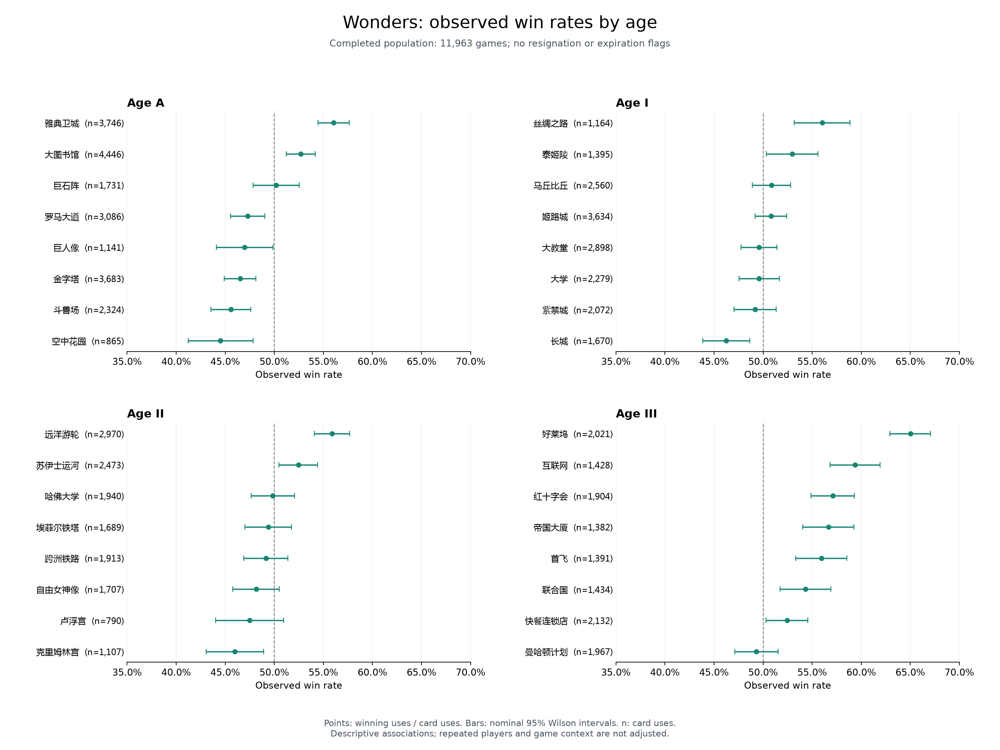

# A worked case study

## The question

Which leaders and wonders were frequently selected, and how often did their users win? Answering this required converting visual game timelines into records, validating player outcomes and card identities, and choosing a clear analysis population.

The historical project processed 14,557 distinct games. The primary descriptive analysis includes 11,963 games without resignation or expiration flags; 2,594 resigned games are presented separately. The work combines image classification with data preparation and analysis judgment.

## 1. Extract and classify game elements

Leader crops are grayscale 144×144 images. Their central 48×48 region becomes 2,304 features; the leader PCA transforms these to 48 components. Wonder crops are 64×120, with 7,680 input features and 70 PCA components. Both PCA models retain 95% variance with whitening. Each transformed vector is classified by K=3 nearest neighbors.

| Public crop | Kind | Historical reference |
| --- | --- | --- |
|  | Leader | 孔子 |
|  | Wonder | 大图书馆 |

These images are copied from preserved historical crops. The public `recognize_crops.py` example loads both original model pairs once and saves raw predictions with input hashes. The full local verification separately ran 20 complete screenshots through cropping, classification, and rule checks.

## 2. Understand a recognition error

An empty wonder region still receives a card label because the trained classifier chooses among known cards. In five resigned screenshot examples, ten extra empty regions were predicted as `丝绸之路`.

| Input | Raw model prediction | Empty-template diagnostic |
| --- | --- | --- |
|  | 丝绸之路 | Difference is above the empty threshold; preserve the card |
|  | 丝绸之路 | Difference is below the empty threshold; record an empty candidate |

Duplicate-card, shared-card and age-order rules flag the affected raw results. The diagnostic compares the first 50×50 grayscale pixels with the preserved empty-wonder template, summing absolute differences using signed arithmetic. The recorded threshold is 5,000. It records the raw label and candidate finding separately; it does not delete by card name or overwrite predictions.

The historical cleanup notebook records the template idea but has a `cal`/`cal_div` naming inconsistency. The current implementation is a diagnostic of that recorded method, rather than evidence that this exact automated cleanup ran on every historical game. The demonstrated threshold is checked on the supplied samples, not validated for all possible screenshots.

## 3. Join records by identity and position

Screenshot position does not determine the winner. The preparation code joins on game identity and maps `top` to position 0 and `bottom` to position 1. Player source order can differ, so joins do not rely on row number or source slot.

The normalized tables represent games, players, four leader-era slots per player, and variable-length wonder lists. Validation rejects duplicate keys, missing counterparts, ambiguous winners, unknown card names and inconsistent position mappings.

In the full local archive, the early workbook comparison matched all 141,453 winner/loser and card fields. The 4,339-game text source also contained 2,075 conflicting outcome records. Preparation used workbook outcomes under a declared policy and exported every discrepancy. This is a reconciliation decision, rather than an inference from screenshot order.

The public sample retains card/outcome values and consistent pseudonyms but omits original usernames, game identifiers and source-row metadata. Run its analysis example to inspect the joins and denominators directly.

## 4. Interpret statistics with denominators and uncertainty

For each card, selection rate is uses divided by games; observed win rate is wins divided by uses. Player usage rate, with twice the game count as denominator, is exported separately. The `无` placeholders for absent leaders are tracked as coverage and excluded from the 48 leader categories.

In the full primary population, `好莱坞` has **2,021 uses**, with observed win rate **65.02%** and nominal Wilson interval **62.91%–67.07%**. This describes the recorded users' results. It does not establish that choosing the card causes a 65% chance of winning.

The III-era absent-leader share is **7.28%** in the primary population and **76.27%** in resigned games. This supports reporting the populations separately. Similarly, `首飞` appears only **3 times** in resigned games, so its large rate difference is presented alongside the small count.

The analysis also checks sensitivity to adding resigned games and excluding pending recognition cases. Original Excel statistics were independently recomputed: **252 values across 84 rows, zero mismatches**. Comparison with historical values establishes calculation consistency, rather than recognition accuracy or causal validity.

## Read or run the evidence

- [Full aggregate report](../reports/statistics/report.md): all population definitions, examples and sensitivity results.
- [Metrics and data dictionary](methods.md): formulas, assumptions and public table fields.
- [Analysis example](../examples/analyze_sample.py): executable sample validation and aggregation.
- [Recognition example](../examples/recognize_crops.py): successful predictions and the empty-region case.
- [Verification scope](verification.md): distinguishes local full-archive checks from public demonstrations.
