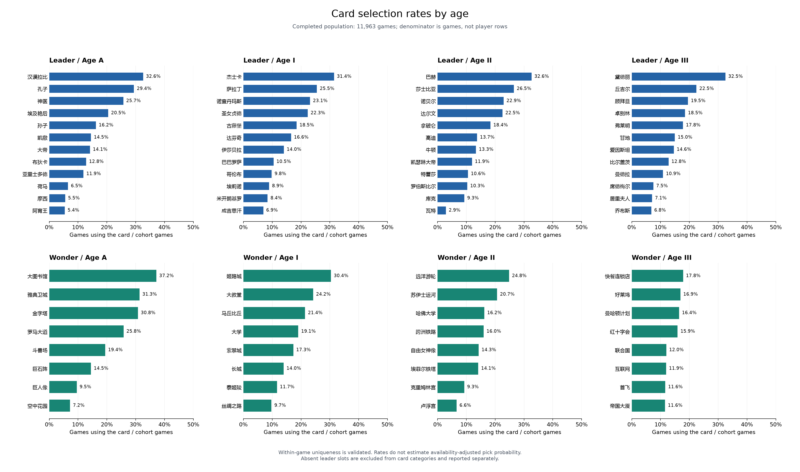

# Through the Ages: descriptive analysis

This report automates the statistical part of a historical personal project. The original workflow used manual Excel import and formulas; this Python report is current refactoring.

## Populations

The primary population contains **11,963 games** with neither resignation nor expiration flags. The supplied canonical archive has **14,557 distinct games**. The views below overlap; their counts must not be added.

| Population | Games | Unique usernames | Expiration-flagged games | Pending review games |
| --- | ---: | ---: | ---: | ---: |
| completed | 11,963 | 519 | 0 | 3 |
| resigned | 2,594 | 368 | 17 | 0 |
| resigned_no_expiration | 2,577 | 367 | 0 | 0 |
| all_processed | 14,557 | 544 | 17 | 3 |
| historical_5239 | 5,239 | 318 | 0 | 2 |
| later_6724 | 6,724 | 376 | 0 | 1 |
| completed_without_review_cases | 11,960 | 519 | 0 | 0 |

Resigned games include 17 games also carrying an expiration flag. Flags are preserved even when they belong to the winning player. Three age-order review cases remain pending; exclusion is a sensitivity view, not an assertion of recognition error.

## Metric definitions

- **Selection rate:** card uses / population games. Each card can occur at most once in a game; this is validated. It is not divided by player rows or estimated card availability.
- **Player usage rate:** card uses / (2 × population games), provided separately in the CSV.
- **Observed win rate:** winning uses / all uses of that card. Counts, wins, losses, and unique usernames are exported.
- **Intervals:** nominal 95% Wilson binomial intervals, z = 1.96. Zero-use cards have no estimated win rate or interval.
- **Absent leaders:** the four era-specific ‘无’ placeholders are retained for coverage and historical comparison, and excluded from the 48 leader categories.

The interval calculation follows the [NIST Wilson method](https://www.itl.nist.gov/div898/handbook/prc/section2/prc241.htm). Repeated players, game state, other card choices, and card availability are not controlled. Intervals do not adjust for dependence or multiple comparisons. These are descriptive associations, not causal estimates of card strength.

## Primary-population examples

The table shows the highest observed win rate and most used card within each kind and age. All 80 categories, including sample sizes and intervals, are in [card_statistics.csv](card_statistics.csv).

| Kind | Age | Highest observed win rate | Uses | Win rate (Wilson interval) | Most used card | Selection rate |
| --- | --- | --- | ---: | --- | --- | ---: |
| leader | A | 孔子 | 3,517 | 54.51% (52.86%–56.15%) | 汉谟拉比 | 32.59% |
| leader | I | 埃莉诺 | 1,070 | 55.05% (52.05%–58.00%) | 杰士卡 | 31.44% |
| leader | II | 巴赫 | 3,900 | 55.18% (53.61%–56.73%) | 巴赫 | 32.60% |
| leader | III | 黛德丽 | 3,888 | 53.70% (52.13%–55.27%) | 黛德丽 | 32.50% |
| wonder | A | 雅典卫城 | 3,746 | 56.03% (54.44%–57.62%) | 大图书馆 | 37.16% |
| wonder | I | 丝绸之路 | 1,164 | 56.01% (53.15%–58.84%) | 姬路城 | 30.38% |
| wonder | II | 远洋游轮 | 2,970 | 55.89% (54.10%–57.67%) | 远洋游轮 | 24.83% |
| wonder | III | 好莱坞 | 2,021 | 65.02% (62.91%–67.07%) | 快餐连锁店 | 17.82% |

## Leader coverage

Absent slots describe the recorded result; an absent slot alone does not establish a recognition failure.

| Age | Completed absent slots | Completed absent share of player slots | Resigned absent slots | Resigned absent share |
| --- | ---: | ---: | ---: | ---: |
| A | 578 | 2.42% | 154 | 2.97% |
| I | 477 | 1.99% | 368 | 7.09% |
| II | 607 | 2.54% | 1,224 | 23.59% |
| III | 1,743 | 7.28% | 3,957 | 76.27% |

## Population sensitivity

Deltas are **comparison minus baseline**, in percentage points (pp). The table shows the largest absolute win-rate change across the 80 cards for each comparison; this selection is descriptive, not a significance test. See [sensitivity.csv](sensitivity.csv) for every card.

| Baseline → comparison | Card | Baseline uses | Comparison uses | Win-rate delta (pp) |
| --- | --- | ---: | ---: | ---: |
| completed → all_processed | 成吉思汗 | 827 | 1,014 | -2.022 |
| completed → resigned | 首飞 | 1,391 | 3 | +44.069 |
| completed → completed_without_review_cases | 瓦特 | 346 | 345 | -0.170 |
| resigned → resigned_no_expiration | 席德梅尔 | 26 | 25 | +1.692 |
| historical_5239 → later_6724 | 卢浮宫 | 361 | 429 | -9.508 |

## Historical Excel verification

Python independently recomputed **252 saved values** across **84 rows** (80 card rows and four absent-leader rows) in the 5,239-game workbook: **0 mismatches**. COUNTIF formula layouts and game denominators were checked. The workbook was read unchanged, not recalculated in native Excel.

The historical score is `Wilson lower bound / historical scale × 50`. The scale is 0.4656 for leaders; wonder scales are 0.471, 0.4688, 0.4646, and 0.4645 for ages A, I, II, III. This original scaled score is preserved only in the comparison table, without treating its constants as a calibrated strength model. Rates match within 1e-12 and scores within 1e-8 absolute tolerance.

See [historical_comparison.csv](historical_comparison.csv) for source cell addresses and differences. Input hashes, versions, population counts, and figure names are recorded in [analysis.json](analysis.json).

## Figures

Each figure is also exported as SVG for publication.

## Files

- [cohorts.csv](cohorts.csv): explicit population counts and definitions.
- [card_statistics.csv](card_statistics.csv): 80 cards × 7 population views = 560 rows.
- [leader_coverage.csv](leader_coverage.csv): four leader eras × 7 views = 28 rows.
- [sensitivity.csv](sensitivity.csv): 80 cards × 5 comparisons = 400 rows.
- [historical_comparison.csv](historical_comparison.csv): 84 original Excel rows and 252 value checks.
- [analysis.json](analysis.json): provenance and verification metadata.
